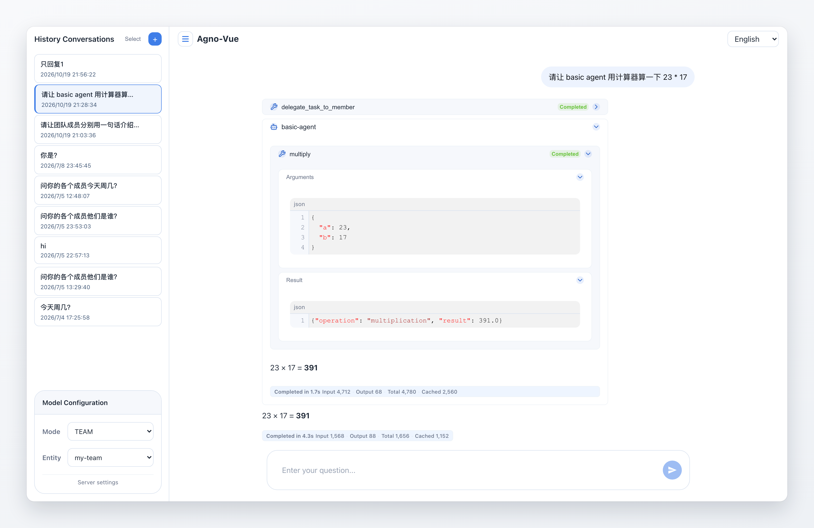
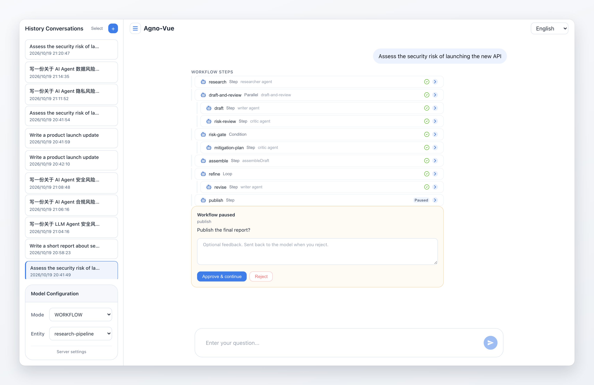

# Agno Vue

基于 Vue 2 的 [Agno](https://docs.agno.com/) 聊天前端。连接 Agno 后端后，可以在同一套界面中使用 **Agent**、**Team** 和 **Workflow**，并支持 SSE 流式输出、渐进式 Markdown 渲染、历史会话以及工作流人工审批。

[English](README.md)

## 预览

Team 工具调用与每轮 token 用量：



Workflow 人工审批：



## 功能

### Agent、Team 与 Workflow

- 在侧栏切换 **Agent**、**Team**、**Workflow** 三种模式。
- 选择后端暴露的任意 Agent、Team 或 Workflow。
- 服务地址与当前选择会保存在本地。

### 流式输出

- 通过 `POST` 发起运行，并从响应体读取 Server-Sent Events（SSE）。
- 正文、推理内容和工具调用会随事件到达逐步更新。
- 每轮完成的回复都会展示耗时与 token 用量（输入、输出、总计；服务端提供时还包括缓存读取）。
- 运行过程中可以在输入框点击停止（中止前端请求）。

### 富文本消息

- 推理内容块与 `<thinking>` 标签。
- 工具调用展示参数、结果，以及运行中/完成/错误状态。
- Team 成员运行独立展示推理、工具调用、正文和耗时。
- Markdown 支持代码高亮、表格和经过清洗的 HTML。
- 流式安全渲染：先修复未闭合的 Markdown 再解析；文本节点原地追加，避免破坏选区与滚动位置。

### Workflow

- 步骤树支持嵌套容器：顺序步骤、**parallel**、**condition**、**loop**、**router** 和 **steps** 分组。
- 子步骤按层级缩进，并展示执行器名称。
- 每个步骤可展示推理、工具调用、输出、状态和耗时。
- 每个步骤展示 token 用量，整个 Workflow 轮次底部展示聚合后的用量。
- Human-in-the-loop 暂停：
  - 批准并继续。
  - 拒绝，可选填写反馈；按钮文案会根据 `retry` / `skip` 语义变化。
  - 支持确认类暂停（`requires_confirmation` / 输出审查）。其他暂停解析类型会明确提示“不支持”，而不是静默失败。

### 会话

- 按当前实体分页展示历史会话（每页 20 条）。
- 打开历史会话时重建 Agent、Team 和 Workflow 消息。
- 支持单条删除，也支持多选后批量删除。
- 新建会话会插入到第 1 页顶部，同时保持分页数据一致。

### 导航与布局

- 根据用户消息生成聊天目录（TOC），支持平滑跳转和当前项高亮。
- 贴底自动滚动：流式内容增长时持续跟随，用户向上滚动后立即让出控制权。
- 可折叠侧栏、响应式布局、键盘友好的输入框。
- 中文 / English 双语界面。

### 输入快捷键

| 按键 | 行为 |
| --- | --- |
| `Enter` | 发送 |
| `Cmd+Enter`（macOS）/ `Alt+Enter` | 插入换行 |
| 输入法组合中 | 不会误发送 |

## 技术栈

| 领域 | 选型 |
| --- | --- |
| 框架 | Vue 2.6.14 + `@vue/composition-api` |
| 构建 | Vite 8 + `vite-plugin-vue2` + `unplugin-vue2-script-setup` |
| 样式 | Less + Tailwind CSS 4（`tw:` 前缀） |
| 国际化 | vue-i18n 8 |
| Markdown | `marked` + `remend` + `DOMPurify` + `htmlparser2` |
| 代码高亮 | `highlight.js` |
| 虚拟列表 | `vue-virtual-scroller` |
| 测试 | Node.js 内置 `node:test` |

## 环境要求

- Node.js **>= 20.19.0**
- pnpm
- 正在运行的 Agno 服务（下文以 `http://localhost:7777` 为例）

## 快速开始

### 1. 启动后端

启动任意实现了 `/agents`、`/teams`、`/workflows`、`/sessions` 及运行接口的 Agno 服务。如果使用 DeepSeek，可以直接运行包含完整 Agent、Team、Workflow 示例的 [agno-deepseek](https://github.com/ehehaye/agno-deepseek)。

### 2. 安装依赖

```bash
pnpm i
```

### 3. 启动开发服务器

```bash
pnpm dev
```

Vite 默认监听 `http://localhost:5173`，并将 `/agno` 代理到 `http://localhost:7777`（会去掉前缀）。

### 4. 连接服务

首次启动会跳转到 `/#/setup`。默认地址是：

```text
http://localhost:5173/agno
```

它走 Vite 代理。也可以填写绝对地址，例如 `http://localhost:7777`；此时 Agno 服务需要允许来自前端源的跨域请求。

进入聊天前，应用会先请求 `/agents`、`/teams` 和 `/workflows` 验证连通性。

### 5. 生产构建

```bash
pnpm build
```

静态产物输出到 `dist/`，可部署到任意静态服务器。路由使用 hash 模式，无需服务端重写规则。

生产环境可以选择：

- 将 `/agno` 反向代理到 Agno 服务（与 Vite 代理行为一致）；或
- 在 Setup 页面填写绝对 `serverUrl`，并在 Agno 服务开启 CORS。

## 命令

| 命令 | 说明 |
| --- | --- |
| `pnpm dev` | 在 5173 端口启动 Vite 并打开浏览器 |
| `pnpm build` | 生产构建到 `dist/` |
| `pnpm preview` | 本地预览构建产物 |
| `pnpm test` | 使用 Node 测试运行器执行单元测试 |
| `pnpm lint` | ESLint 并自动修复（会修改文件） |
| `pnpm lint:check` | ESLint 只检查、不写入 |

提交前建议依次执行：

```bash
pnpm lint:check
pnpm test
pnpm build
```

## 后端接口

前端使用以下 Agno 接口。

| 方法 | 路径 | 用途 |
| --- | --- | --- |
| `GET` | `/agents`、`/teams`、`/workflows` | 连通性校验与实体列表 |
| `POST` | `/{agents\|teams\|workflows}/{id}/runs` | 发起运行。表单字段：`message`、`stream=true`、可选 `session_id` |
| `POST` | `/workflows/{workflow_id}/runs/{run_id}/continue` | 恢复暂停的 Workflow。表单字段：`session_id`、`stream=true`、`step_requirements`（JSON） |
| `GET` | `/sessions?type=&component_id=&page=&limit=` | 分页获取会话列表 |
| `GET` | `/sessions/{session_id}/runs` | 获取历史运行记录并重建会话 |
| `DELETE` | `/sessions` | 删除会话。JSON 请求体：`{ "session_ids": [...], "session_types": [...] }` |

运行请求使用 `Content-Type: application/x-www-form-urlencoded`。流式响应由可跨 chunk 边界解析的缓冲式 SSE 解析器处理。

### Workflow `step_requirements`

Workflow 暂停时，前端会为每个暂停步骤发送一条记录：

```json
[
  {
    "step_id": "...",
    "step_name": "...",
    "step_index": 0,
    "step_type": "Step",
    "requires_confirmation": true,
    "confirmed": true,
    "on_reject": "retry",
    "rejection_feedback": "可选反馈"
  }
]
```

批准时 `confirmed` 为 `true`，拒绝时为 `false`。只有 `on_reject` 为 `retry` 时，Agno 才会消费 `rejection_feedback`。

## 本地配置

配置通过 `localStorage` 持久化，键名统一带 `agno-vue:` 前缀：

| 键 | 含义 |
| --- | --- |
| `serverUrl` | Agno 服务地址 |
| `entity` | 最近选择的 `{ type, id, name }` |
| `locale` | `zh` 或 `en` |

开发代理与路径别名位于 `vite.config.js`：

- `@` → `src/`
- `/agno` → `http://localhost:7777`（去掉前缀）
- Less 变量与 mixin 会自动注入每个样式块。

界面文案位于 `src/lang/en.js` 和 `src/lang/zh.js`。

## 目录结构

```text
src/
├── components/
│   ├── ui/                  # 与业务无关的通用组件
│   │   ├── Collapse.vue
│   │   ├── Sender.vue
│   │   ├── StickToBottom.vue
│   │   ├── StreamingIndicator.vue
│   │   └── Toc.vue
│   ├── chat/                # 聊天组合与消息渲染
│   │   ├── ChatInterface.vue
│   │   ├── ChatMessage.vue
│   │   ├── Thinking.vue
│   │   ├── customComponents.js
│   │   └── messages/
│   │       ├── AssistantMessage.vue
│   │       ├── UserMessage.vue
│   │       └── blocks/      # ToolCall、Reasoning、MemberRun、
│   │                        # WorkflowStep(s)、WorkflowPause、Duration
│   ├── markdown/            # Markdown 渲染管线
│   ├── layout/              # AppLayout
│   ├── sessions/            # 会话侧栏、列表项、分页器
│   ├── config/              # 模式/实体/服务配置
│   └── icons/
├── constants/               # Role、RunEvent、RunStatus、StepStatus 等
├── hooks/
│   ├── agno/                # 面向后端的单例 hooks 与状态机
│   └── useAutoFocus.js、useCompName.js、usePerfTrack.js
├── utils/                   # SSE 解析、存储、格式化、滚动等
├── views/                   # ChatView、SetupView
├── lang/                    # 中英文文案
├── plugins/                 # Composition API、常量、i18n、虚拟滚动
├── router/
├── assets/styles/
├── App.vue
└── main.js
```

## 工作原理

### 启动与路由

`src/main.js` 安装插件、路由和 i18n。路由守卫会检查本地是否保存了 `serverUrl`，并调用 `ensureConnected()` 验证连接；失败则跳转到 `SetupView`。`ChatView` 组合 `AppLayout`、`SessionSidebar`、`ConfigPanel` 和 `ChatInterface`。

### 发起运行

`useAgentRun.sendMessage()` 的流程：

1. 追加用户消息并创建 `AbortController`。
2. POST 发起运行，读取响应体流。
3. 将解码后的 chunk 交给 `SSEParser`，逐个分发事件。

Agent / Team 事件由 `runState.js` 中的纯状态转换处理；Workflow 事件（包括带 `step_id` 的嵌套 Agent / Team 事件）由 `workflowState.js` 处理。所有运行状态都以不可变方式更新。

### Workflow 暂停

`StepPaused`、`StepOutputReview` 和 `StepExecutorPaused` 会在运行状态中记录 `pausedRequirement`。`WorkflowPauseBlock` 渲染审批卡片并调用 `continueRun()`。继续执行后，Agno 可能生成新的 `step_id`，因此前端会先按 `step_id` 匹配，失败后回退到 `step_name` + `step_index`。

### 历史会话重建

`historyMapper.js` 将 `/sessions/{id}/runs` 转换为与流式过程一致的消息/运行结构，包括成员运行、工具调用和扁平化后的 Workflow 步骤。

### Markdown 管线

`marked` 负责解析（解析前由 `remend` 修复流式过程中的残缺 Markdown），`DOMPurify` 负责清洗，`htmlparser2` 构建 AST，最终由 `NodeRenderer` 渲染。`TextNodeRenderer` 在流式过程中向既有文本节点追加内容而不是整体替换，从而保留选区。`<thinking>` 等自定义标签通过 `customComponents.js` 注册。

### 滚动与目录

`StickToBottom` 负责贴底跟随，并监听内容与容器尺寸变化，因此 Markdown 最终排版完成后仍能继续贴底。用户主动上滚时停止跟随，滚回底部后恢复。`Toc` 只负责展示；`ChatInterface` 从用户消息生成目录项，并根据真实 DOM 位置计算当前项。

## 开发说明

- 架构细节、代码约定与常见坑见 [AGENTS.md](AGENTS.md)。
- 单元测试覆盖 SSE 解析、运行/Workflow 状态转换、历史映射、格式化、会话与滚动辅助函数。
- 已针对本地 Agno 后端完成手工验证，包括 Agent、Team、Workflow、暂停/继续、历史加载、目录跳转、会话分页与删除、语言切换。

## 已知限制

- Vue 2 已结束官方维护。项目目前仍停留在 Vue 2，但状态逻辑尽量与框架解耦，便于将来迁移。
- Workflow 审批目前支持确认与输出审查类暂停；用户输入、外部执行等解析类型会显示为不支持。
- 取消运行只会中止前端请求，后端可能继续执行。
- 项目本身不含鉴权，请自行在部署层增加访问控制。
- SSE 需要代理不缓冲响应体。

## 参考

- [Agno 官方文档](https://docs.agno.com/)
- [Agno Agent UI](https://github.com/agno-agi/agent-ui)
- [Agno Client](https://github.com/rodrigocoliveira/agno-client)
- [agno-deepseek 示例后端](https://github.com/ehehaye/agno-deepseek)

## 许可证

MIT
